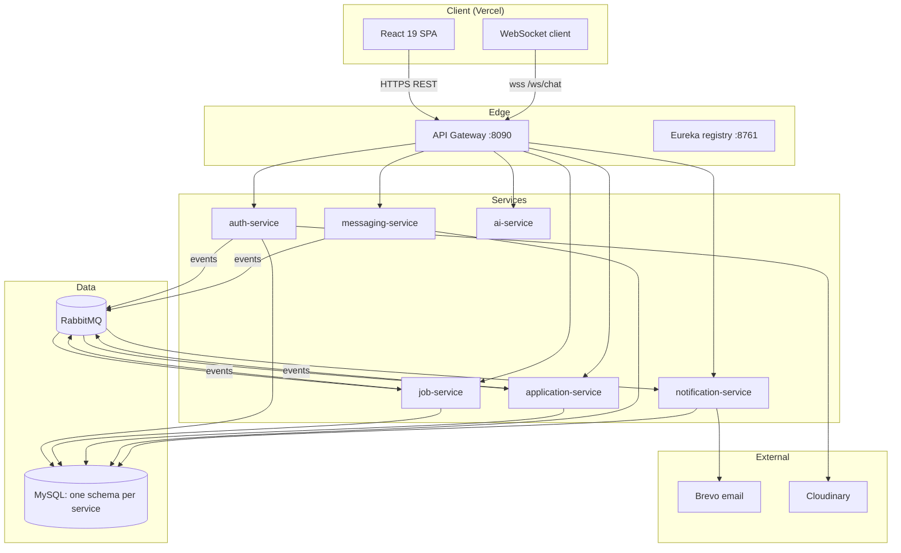
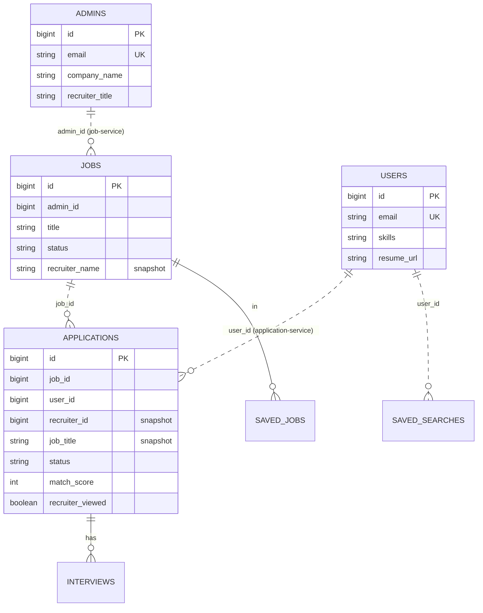
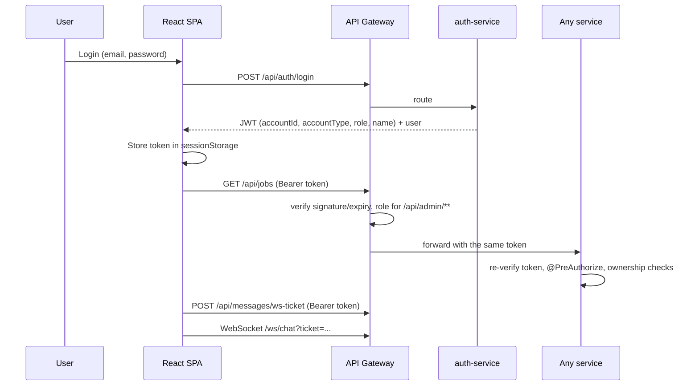
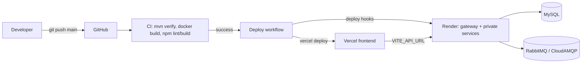

# Architecture

System design for the Job Board platform: a React SPA in front of a **Spring Boot microservices** backend
(API gateway, service registry, six domain services, database per service, RabbitMQ events).

Deep dives live in [microservices/](microservices/README.md): services, events, running, migration history, decisions.

---

## System overview



| Service | Owns |
|---|---|
| auth-service | Candidates (`users`), recruiters (`admins`), login/JWT, password-reset OTPs, profiles, avatars, resumes |
| job-service | Jobs, saved jobs, job alerts, company pages, public stats |
| application-service | Applications, interviews, recruiter dashboard and analytics |
| messaging-service | Recruiter-candidate chat (REST + WebSocket) |
| notification-service | In-app notifications, OTP emails (event-driven only) |
| ai-service | Match scoring, AI job descriptions (stateless) |

Services talk synchronously through **OpenFeign** for queries they need to answer a request, and asynchronously
through **RabbitMQ events** for side effects (notifications, emails, keeping copied data fresh). Details:
[microservices/ARCHITECTURE.md](microservices/ARCHITECTURE.md).

---

## Service internal layers

Every domain service follows the same layout under `com.globalco.jobboard.<service>`:

```
controller/     REST endpoints (/api/**) and internal endpoints (/internal/**)
service/        Business logic, transactions, Feign calls to other services
repository/     Spring Data JPA (own schema only)
model/          JPA entities
event/          RabbitMQ listeners + queue declarations
```

Shared plumbing comes from the `common` module: API DTOs, exceptions, JWT security, Feign clients, event contracts.

---

## Frontend layers

```
pages/          Route-level views (Home, Jobs, Dashboard, Admin, …)
components/     Reusable UI (Navbar, JobCard, ChatPanel, …)
components/ui/  Design system (shadcn/ui primitives, Pagination, EmptyState, Skeletons)
context/        AuthContext, ThemeContext
services/       Axios API client, WebSocket, auth storage
utils/          Formatters, recruiter company resolution, branding
```

The frontend talks only to the gateway (`VITE_API_URL`); it doesn't know how the backend is split.

---

## Data model

Each service owns its tables; cross-service references are plain ids with no foreign keys between schemas.



| Schema | Tables |
|---|---|
| `jobboard_auth` | `users`, `admins`, `password_reset_otps` |
| `jobboard_jobs` | `jobs`, `saved_jobs`, `saved_searches` |
| `jobboard_applications` | `applications`, `interviews` |
| `jobboard_messaging` | `messages` (polymorphic `sender_type`/`receiver_type`: `ADMIN` or `USER`) |
| `jobboard_notifications` | `notifications` |

Dotted relations cross service boundaries. "Snapshot" columns are read-only copies kept fresh by events
(`account.recruiter-updated`, `job.updated`), which keeps recruiter dashboards as single local SQL queries.
The schema is managed by Flyway migrations in each service (`src/main/resources/db/migration`); Hibernate only validates it.
The four services that publish events also have an `event_outbox` table (see [microservices/EVENTS.md](microservices/EVENTS.md)).

---

## Authentication flow



1. auth-service validates credentials against `users` or `admins` (BCrypt) and signs an HS256 JWT (24 h).
2. The frontend stores it in **sessionStorage** (a recruiter and a candidate can be signed in in separate tabs).
3. The gateway rejects missing/invalid tokens on protected routes and non-admins on `/api/admin/**` and `/api/ai/**`.
4. Every service re-validates the token (defence in depth) and identifies the caller from its claims, with no call to auth-service.

---

## Security model

| Layer | Mechanism |
|-------|-----------|
| Transport | HTTPS (Vercel + Render) |
| Auth | Stateless JWT, BCrypt passwords |
| Authorization | Role-based (`ROLE_USER` vs `ROLE_ADMIN`) at the gateway and in each service |
| Service-to-service | `/internal/**` APIs need a shared `X-Internal-Token`; the gateway returns 404 for them |
| Privacy | Candidate PII masked until `recruiterViewed=true` |
| Messaging | Recruiter initiates; candidate replies only after the first message |
| CORS | Handled once at the gateway (`CORS_ORIGINS`) |
| Files | Auth required for `/api/files/**`; resumes stored by auth-service, avatars on Cloudinary |

Public endpoints: `/api/auth/**`, `/api/public/**`, `GET /api/jobs/**`, `GET /api/companies/**`, `/ws/**`

---

## Deployment architecture



| Component | Technology |
|-----------|------------|
| Frontend host | Vercel (Vite build, SPA rewrites) |
| Backend host | Render Blueprint (`render.yaml`): public gateway, private registry and services; or any Docker host via `backend/docker-compose.yml` |
| Database | MySQL 8 (Railway or similar), one schema per service |
| Messaging | RabbitMQ (CloudAMQP in production) |
| Email | Brevo HTTP API |
| CI/CD | GitHub Actions |

---

## Related documentation

- [microservices/](microservices/README.md): services, events, running locally, decisions
- [WORKFLOWS.md](WORKFLOWS.md): end-to-end user journeys
- [API.md](API.md): REST endpoints
- [DEPLOYMENT.md](DEPLOYMENT.md): production setup
