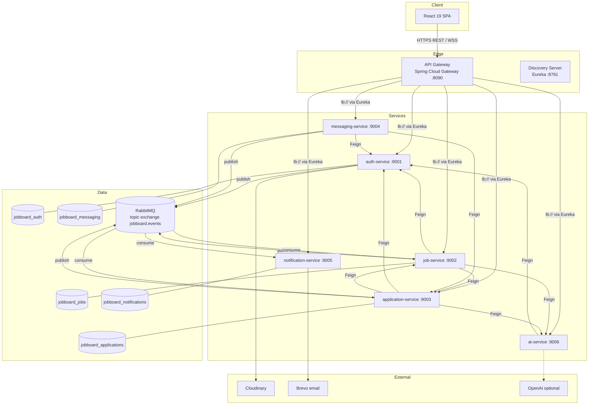
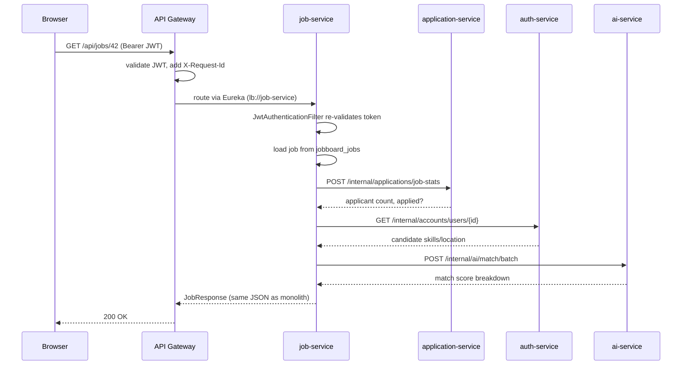
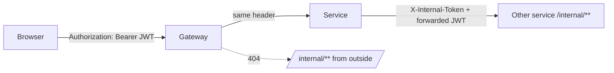

# Architecture

## 1. Overview

Every service is a Spring Boot 3.3 application (Java 21) built from one Maven multi-module project in `backend/`.
The shared `common` module holds the API DTOs, exceptions, JWT security, Feign clients and event contracts, so the
public JSON contract is byte-for-byte the one the monolith served.

## 2. How a request flows

Example: a candidate opens a job page (`GET /api/jobs/42`).

The enrichment calls are best-effort: if application-service or ai-service is down, the job still renders,
without the applicant count or match badge (see `JobEnricher`).

## 3. Communication styles

| Style | Technology | Used when | Examples |
|---|---|---|---|
| Synchronous query | OpenFeign over HTTP, load-balanced through Eureka | The caller needs the answer to build its response | job-service asks application-service for applicant counts; application-service fetches the job before accepting an application |
| Asynchronous event | RabbitMQ topic exchange `jobboard.events` | Something happened and others may react; the caller must not wait or fail because of them | `application.submitted` makes notification-service notify both sides; `job.updated` refreshes application copies |

Rules of thumb applied throughout:

- **Commands that change another service's data are never synchronous.** A service changes only its own database;
  other services follow through events.
- **Batch, never N+1.** Lists use batch endpoints (`/users/batch`, `/match/batch`, `/viewed-candidates`), so a page
  costs a constant number of remote calls regardless of its size.
- **Remote calls happen outside database transactions** (application-service uses `TransactionTemplate` around the
  local write only), so a slow downstream service never holds a connection from the pool.
- **Events are published after commit** (`EventPublisher` registers an `afterCommit` hook), so consumers never see
  data that was rolled back.

## 4. Data ownership and duplication

Each service owns one schema and is the only one that reads or writes it. Cross-service references are plain ids
(`user_id`, `recruiter_id`, `job_id`) with no foreign keys across schemas.

Where a service needs another service's data on its hot path, it keeps a **read-only copy (snapshot)** that the owner
keeps fresh with events:

| Copy lives in | Copied fields | Source of truth | Refreshed by |
|---|---|---|---|
| `jobboard_jobs.jobs` | recruiter name, company description, website, title | auth-service | `account.recruiter-updated` |
| `jobboard_applications.applications` | `recruiter_id`, job title, company | job-service | `job.updated` (`job.deleted` removes the applications) |

This is what lets the recruiter dashboard (12 aggregate queries in the monolith, all joining `applications -> jobs -> admins`)
run entirely inside application-service.

## 5. Security model

| Layer | What is enforced | Where |
|---|---|---|
| Gateway | Token signature/expiry on protected routes; `ROLE_ADMIN` for `/api/admin/**` and `/api/ai/**`; `/internal/**` returns 404; CORS | `AuthenticationGatewayFilter`, `CorsConfig` |
| Every service | Re-validates the JWT (defence in depth: a service reachable without the gateway is still protected); `@PreAuthorize` and ownership checks exactly as in the monolith | `common/security/*` |
| Internal APIs | `/internal/**` requires the shared `X-Internal-Token` (constant-time comparison) | `InternalApiFilter` |

- **Token contents:** `sub` = email, plus `accountId`, `accountType` (USER/ADMIN), `role`, `name`. Services identify the
  caller from the token alone, so no service calls auth-service just to find out who is calling.
- **Secrets:** `JWT_SECRET` and `INTERNAL_API_TOKEN` must be the same for all services and set from the environment in
  production (the defaults are for local development only).
- **Status codes** keep the monolith's contract: bad credentials return 400, not 401, because the frontend treats any 401
  as "session expired" and logs the user out.
- **WebSocket:** browsers cannot send headers on a WebSocket handshake, so the client trades its JWT for a single-use,
  30-second ticket (`POST /api/messages/ws-ticket`) and connects to `/ws/chat?ticket=...`. messaging-service redeems
  the ticket itself; the gateway only proxies the connection.

## 6. Resilience

| Concern | Mechanism |
|---|---|
| A dependency is down | Enrichment calls degrade gracefully (no match badge, masked names, zero job counts) instead of failing the page |
| Downstream errors | Feign `ErrorDecoder` maps 400/404/401 back to the same exceptions (so messages reach the browser unchanged); anything else becomes 503 |
| Timeouts | Feign: 3 s connect, 10 s read. Gateway: 5 s connect, 60 s response |
| A consumer keeps failing | 3 attempts with exponential backoff, then the message is moved to `<queue>.dlq` for inspection/replay |
| Broker is down | Publishing is logged, never thrown: the user's action already succeeded |
| Correlation | The gateway sets `X-Request-Id`; Feign forwards it to every downstream call |
