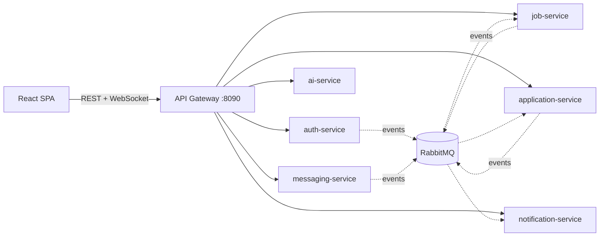

# Microservices Architecture

The Job Board backend lives in `backend/`: 6 domain services, an API gateway and a service registry, one database
schema per service, and RabbitMQ events. It replaced the original single Spring Boot application (see
[MIGRATION.md](MIGRATION.md)) while keeping the REST API identical, so the React frontend only needs `VITE_API_URL`
pointing at the gateway (`http://localhost:8090` locally).

## Documents

| Document | What it covers |
|---|---|
| [ARCHITECTURE.md](ARCHITECTURE.md) | Big picture, request flow, sync vs async communication, security model |
| [SERVICES.md](SERVICES.md) | Service catalogue, data ownership, gateway routes, internal APIs, who calls whom |
| [EVENTS.md](EVENTS.md) | Event catalogue (RabbitMQ), queues, retries and dead-letter queues |
| [RUNNING.md](RUNNING.md) | Running locally (JVMs or Docker Compose), smoke test, troubleshooting |
| [MIGRATION.md](MIGRATION.md) | How the original monolith was split, data migration, behaviour differences |
| [DECISIONS.md](DECISIONS.md) | Design decisions, trade-offs and known limitations |

## At a glance



| Service | Port | Database | Owns |
|---|---|---|---|
| api-gateway | 8090 | - | Single entry point, JWT check, CORS, routing |
| discovery-server | 8761 | - | Eureka service registry |
| auth-service | 9001 | `jobboard_auth` | Accounts, login, OTP, profiles, avatars, resumes |
| job-service | 9002 | `jobboard_jobs` | Jobs, saved jobs, job alerts, company pages, public stats |
| application-service | 9003 | `jobboard_applications` | Applications, interviews, recruiter dashboard/analytics |
| messaging-service | 9004 | `jobboard_messaging` | Recruiter-candidate chat (REST + WebSocket) |
| notification-service | 9005 | `jobboard_notifications` | In-app notifications, OTP emails |
| ai-service | 9006 | - (stateless) | Match scoring, AI job descriptions |

## Quick start

```powershell
cd backend
.\mvnw.cmd -B install -DskipTests
docker run -d --name jobboard-rabbitmq -p 5672:5672 -p 15672:15672 rabbitmq:3.13-management
.\scripts\run-local.ps1 -DbPassword <mysql-root-password>
.\scripts\smoke-test.ps1
```

Or, fully containerised: `docker compose up -d --build` from `backend/`. Details in [RUNNING.md](RUNNING.md).
