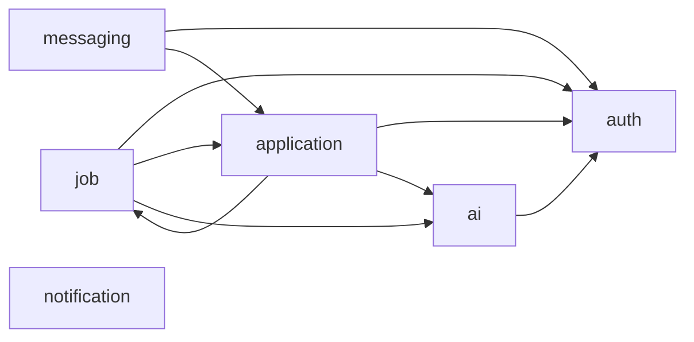

# Service Catalogue

## Module layout (`backend/`)

```
backend/
├── pom.xml                  parent: Spring Boot 3.3.5, Spring Cloud 2023.0.3, Java 21
├── common/                  shared library (not a service)
│   ├── dto/request|response   public API contract (identical to the monolith)
│   ├── dto/internal           service-to-service payloads (UserSummary, JobSummary, MatchInput...)
│   ├── client/                Feign clients for every internal API
│   ├── event/                 event records, routing keys, RabbitMQ config, EventPublisher
│   ├── security/              JWT, AccountPrincipal, CurrentAccount, internal-token filter
│   ├── exception/             exceptions + GlobalExceptionHandler
│   └── resources/jobboard-shared.yml   defaults imported by every service
├── discovery-server/        Eureka
├── api-gateway/             Spring Cloud Gateway (WebFlux)
├── auth-service/
├── job-service/
├── application-service/
├── messaging-service/
├── notification-service/
├── ai-service/
├── docker-compose.yml, Dockerfile, docker/mysql-init/
└── scripts/                 run-local.ps1, stop-local.ps1, smoke-test.ps1, migrate-from-monolith.sql
```

## Services

### auth-service (9001, `jobboard_auth`)
Owns `users` (candidates), `admins` (recruiters), `password_reset_otps`, uploaded files.

- Public: `/api/auth/**` (register, login, forgot/reset password), `/api/users/me/**` (profile, avatar, resume, password), `/api/files/**`
- Internal: account summaries and candidate search for other services, resume upload on behalf of application-service
- Also: login throttling (5 failures / 15 min per email), account deletion (`DELETE /api/users/me`, publishes `account.deleted`)
- Publishes: `account.recruiter-updated`, `account.password-reset-otp`, `account.deleted`
- Calls: application (only to decide who may download a resume; denies if unavailable)

### job-service (9002, `jobboard_jobs`)
Owns `jobs` (+ recruiter snapshot), `saved_jobs`, `saved_searches`.

- Public: `/api/jobs/**`, `/api/admin/jobs`, `/api/saved-jobs/**`, `/api/saved-searches/**`, `/api/companies/{id}`, `/api/public/**`
- Internal: job summaries, recruiter job statistics
- Publishes: `job.created`, `job.updated`, `job.deleted`
- Consumes: `account.recruiter-updated` (refreshes the recruiter snapshot on all of that recruiter's jobs), `account.deleted`
- Calls: auth (recruiter on job creation, candidate profile for match previews), application (applicant counts / applied flags), ai (batch match scores)

### application-service (9003, `jobboard_applications`)
Owns `applications` (+ job snapshot and `recruiter_id`), `interviews`.

- Public: `/api/applications/**`, `/api/admin/dashboard`, `/api/admin/applicants`, `/api/admin/analytics/**`
- Internal: per-job applicant stats, "has recruiter viewed this candidate", recruiter's candidate ids, resume access check
- Publishes: `application.submitted`, `application.status-changed`, `application.interview-scheduled`
- Consumes: `job.updated`, `job.deleted`, `account.deleted`
- Calls: job (job details/status, recruiter job stats), auth (candidate details, resume upload, applicant name search), ai (match score)

### messaging-service (9004, `jobboard_messaging`)
Owns `messages`; holds open WebSocket sessions.

- Public: `/api/messages/**`, WebSocket `/ws/chat?ticket=<ticket>` (ticket from `POST /api/messages/ws-ticket`)
- Publishes: `message.sent`
- Consumes: `account.deleted`
- Calls: auth (participant names, company), application (identity unlock rules, recruiter's candidates)

### notification-service (9005, `jobboard_notifications`)
Owns `notifications`; sends email.

- Public: `/api/notifications/**`
- Consumes: `job.created`, `application.*`, `message.sent`, `account.password-reset-otp`, `account.deleted`
- Calls: nobody. Purely event-driven, so it can be down without breaking any user action.

### ai-service (9006, stateless)
- Public: `/api/ai/generate-job-description` (recruiters)
- Internal: `/internal/ai/match`, `/internal/ai/match/batch`
- Calls: auth (recruiter profile to personalise generated descriptions)

### api-gateway (8090) and discovery-server (8761)
Infrastructure only; no business logic. See the route table below.

## Gateway routes

Evaluated top to bottom; the first match wins.

| Path | Routed to |
|---|---|
| `/api/auth/**`, `/api/users/**`, `/api/files/**` | auth-service |
| `/api/admin/jobs`, `/api/admin/jobs/**` | job-service |
| `/api/jobs/**`, `/api/saved-jobs/**`, `/api/saved-searches/**`, `/api/companies/**`, `/api/public/**` | job-service |
| `/api/applications/**`, `/api/admin/**` | application-service |
| `/ws/**` (WebSocket) | messaging-service |
| `/api/messages/**` | messaging-service |
| `/api/notifications/**` | notification-service |
| `/api/ai/**` | ai-service |
| `/v3/api-docs/<service>` | that service's `/v3/api-docs` (Swagger UI at `/swagger-ui.html`) |
| `/internal/**` | blocked (404) |

Access rules at the gateway mirror the monolith's `SecurityConfig`: `/api/auth/**`, `/api/public/**`, `/ws/**` are public;
`GET /api/jobs/**` and `GET /api/companies/**` are public; `/api/admin/**` and `/api/ai/**` need `ROLE_ADMIN`; everything
else needs a valid token.

## Internal APIs

All require the `X-Internal-Token` header (added automatically by the shared Feign configuration) and are unreachable through the gateway.

| Owner | Endpoint | Used by | Purpose |
|---|---|---|---|
| auth | `GET /internal/accounts/users/{id}` | job, application, messaging | Candidate summary |
| auth | `POST /internal/accounts/users/batch` | application, messaging | Many candidates in one call |
| auth | `GET /internal/accounts/recruiters/{id}` | job, ai, messaging | Recruiter + company |
| auth | `POST /internal/accounts/recruiters/batch` | messaging | Many recruiters in one call |
| auth | `POST /internal/accounts/users/{id}/resume` (multipart) | application | Store a resume uploaded with an application |
| auth | `POST /internal/accounts/users/search` | application | Which of these candidate ids match a name/email query (applicant search) |
| job | `GET /internal/jobs/{id}` | application | Job summary (status, owner, skills...) |
| job | `POST /internal/jobs/batch` | (available) | Many jobs in one call |
| job | `GET /internal/jobs/recruiters/{id}/stats` | application | Total/open jobs and jobs per category for the dashboard |
| application | `POST /internal/applications/job-stats` | job | Applicant counts + which jobs the viewer applied to |
| application | `GET /internal/applications/recruiter-viewed` | messaging | May this recruiter see/message this candidate? |
| application | `GET /internal/applications/recruiters/{id}/candidates` | messaging | Candidates who applied to the recruiter's jobs |
| application | `GET /internal/applications/recruiters/{id}/viewed-candidates` | messaging | Unlocked identities, for the whole contact list at once |
| application | `GET /internal/applications/resume-access` | auth | May this account download this resume? |
| ai | `POST /internal/ai/match`, `/match/batch` | job, application | Match score breakdown |

## Dependency graph (synchronous calls)



job and application call each other, but only for read-only queries on different code paths (job pages ask for
applicant counts; applying asks for the job). Neither call is made while handling the other, so there is no request cycle.
